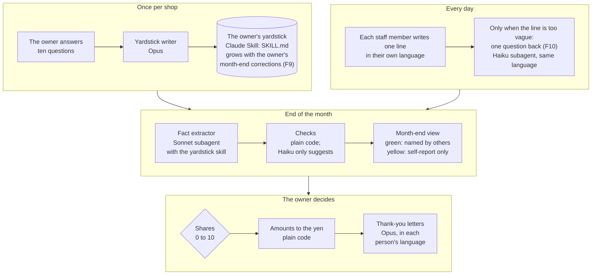

# mienai-ganbari — 見えない頑張りを拾う

> **All data in this repository is fictional.** The café, the staff, and every daily line were made up for this demo.
> **このリポジトリのデータはすべて架空です。** お店・スタッフ・毎日の1行は、このデモのために作ったものです。

**Built with Claude: Japan 2026** — Theme 1: *"The depth only you have" (あなたにしかない深さを。)*

**日本語版はこのページの下にあります → [日本語版](#日本語版)**

Small shops hand out a little extra at the end of the month — a bonus, an allowance, a thank-you.
Too often it goes to the person who talks the most, while the person who quietly mopped the floor, covered a shift,
or taught the new hire goes unnoticed — especially when Japanese is not their first language.

**mienai-ganbari** helps the owner see those quiet efforts:

1. Each staff member writes **one line a day**, in their own language (Japanese, Vietnamese, Indonesian…).
2. Claude turns each line into **plain facts** — who did what for whom — and drops gossip and judgements about character.
3. At the end of the month the owner sees **who was named by others again and again (green)** versus **who mostly reported themselves (yellow)** — every colour links back to the original lines.
4. **The owner decides.** The AI never decides who gets what. Amounts are calculated by plain code to the last yen.
5. Each person receives a short thank-you in their own language, with the concrete reasons.

The builder has run a small business for 18 years and has had to make these month-end calls by hand.
By hand it takes the builder about 30 minutes per person; with this tool, the fictional month for 8 people took 18 minutes from start to the finished letters — about 2 min 15 s per person (F8 ①).

**Try it on your phone:** **https://jojocaw.github.io/mienai-ganbari/** — the fictional café, nothing to install. Write a line as a staff member → decide the month-end thank-yous as the owner → read the letters. (Claude is switched off there: you see the real results Claude produced for the fictional month.)

### How it works



Claude reads and writes; plain code checks every answer and does every calculation; the owner makes every decision.

---

## Status (2026-11-03)

| | Feature | Status |
|---|---|---|
| F1 | Staff write one line a day (phone width, name picked from a list, line saved exactly as written) | ✅ working |
| — | Fictional month: 180 lines over 30 days with a known mix and an answer key | ✅ generated + tested |
| F2 | The owner's yardstick → a Claude **Skill** (`.claude/skills/<shop>-monosashi/SKILL.md`): ten questions, Claude writes a draft, plain code checks it (no character words, every rule points back to an answer), one retry, then the file is written | ✅ first real run: 6 give / 5 don't give / 3 unsure / 7 examples, 3 character words in the answers → 0 in the skill (Opus, ~$0.08) |
| F3 | Fact extractor (subagent; every prompt starts with the owner's Skill as a slash command, so the full yardstick is in its context): line → who did what for whom + the yardstick's verdict; gossip, judgements and vague lines are dropped and only counted. Plain code checks every answer (each line exactly once, people from the list, no character words) | ✅ real run on the fictional month, with the yardstick really in context (the run starts by making the extractor quote it word for word): who did it right for 153/153 lines in Japanese, Vietnamese and Indonesian |
| F4 | Checker: plain code groups the same event (same day, same person, same job) and finds self-report-only claims; a small checker subagent may suggest extra groups, accepted only when safe. Scored against the hidden answer key | ✅ real run: 9/9 duplicates (each written in two different languages), 36/36 self-report-only claims, 27/27 dropped lines, who did it 153/153, for whom 153/153, 0 false alarms · 30 days in 150 s for about $0.70 |
| F5 | Month-end view (`/month`): green / yellow per person; every event opens to its original lines (who wrote them, in which language) and the yardstick's reason; dropped lines are only counted, never shown on anyone's page | ✅ the quiet person: 26 green / 0 yellow (wrote only 3 lines) · the loud person: 3 green / 20 yellow (wrote 32) · the yardstick sorts the 144 events into 37 付ける / 75 迷う (outside the owner's rules, so the owner decides) / 32 付けない |
| F6 | The owner sets each person's yen with + and − (one press = 100 / 500 / 1,000 / 5,000 yen, or type the number) and the total is added up at the bottom, after the last person — changed after the owner tried the screen on 11/3: setting a total first and moving shares 0–10 was hard to follow. Plain TypeScript turns the amounts into exact shares and back (`splitFromAmounts` → `allocate`, nothing left over); a decision kept as shares (the fictional owner's file) is still split to the yen by largest remainder. Claude never calculates money | ✅ fictional decision: 50,000 yen → 11,700 / 5,900 × 6 / 2,900, nothing left over; any yen the owner sets comes back exactly (tested) |
| F7 | Thank-you letters in each person's language: the letter-writer subagent uses only the checked facts and the amount from F6; plain code checks every letter (amount exactly once, no other money, every fact it uses is real, no character words, the right language) and sends it back once with the problems | ✅ real run: 8/8 letters passed (one after a retry), Japanese / Vietnamese / Indonesian, 26 s for about $0.20 |
| F8 | Two numbers for the video: ① the time to make the month-end decision, by hand vs with this tool; ② on twenty made-up scenes the owner answers (付ける / 付けない / 迷う), how often the fact extractor gives the owner's answer **without and with the owner's yardstick skill** — the only difference between the two runs is the skill, and every run first proves the skill is (or is not) in context with a word-for-word quote (`npm run f8`; the owner's answers and skill stay private, only the counts are published in `data/derived/f8.json`) | ② measured with a real shop owner's answers (Sonnet, 3 runs each). **Twenty scenes: without the skill 7, 7, 8 → with the owner's skill 9, 9, 9.** Most misses were small everyday help the owner does not reward (付けない) but Claude does (付ける): the owner's ten written answers say teaching and helping count. **Twelve new scenes the owner answered afterwards** (`npm run f8 -- --round2`, `data/derived/f8-round2.json`): no skill 6, 6, 7 · the skill 5, 5, 5 · **the skill plus the owner's twenty earlier answers as examples 9, 7, 8** · the skill plus the owner's own one-line reason 5, 5, 5 · both 7, 7, 8. The owner's past decisions carried over to new lines (three small everyday scenes, help and tidying, went from 0 of 3 runs to 3 of 3); the one-line reason alone did not move the count. (Inside the twenty, examples from one half tested on the other: 8, 8, 8 → 9, 9, 9, `--examples`.) **① measured once with the same real owner on the fictional month (11/3): by hand, the owner spends about 30 minutes per person, starting three days before the end of the month (about 5 hours for 10 people). With this tool, from "start" to the eight finished letters took 18 min 07 s for 8 people — about 2 min 15 s per person.** The time includes the owner working out the old money screen, which was rebuilt the same day (F6); Claude's preparation (facts and checks, 150 s) ran beforehand and is not included |
| F9 | The owner corrects the month-end verdicts on `/month` (open an event → 店長の答え: 付ける / 迷う / 付けない), and one tap adds those decisions to the yardstick Skill as examples (「店長が実際に決めた例」): word for word, without people's names, by plain code (no Claude). Month after month the section grows; a new decision on the same line replaces the old one; past 60 the oldest leave first; the version before each save is kept in `data/local/skill-history/` and one tap puts it back. Why examples: in F8 ② the owner's past decisions carried over to new lines (5 → 9, 7, 8 of 12) while a one-line reason did not | ✅ working (6 tests; not yet measured on a second month) |
| F10 | One question back, right after a line is saved: when a line is too vague to say who did what (「いろいろ手伝いました。」), the `asker` subagent asks the writer **one** short question in the writer's own language; gossip, judgements and feelings are never asked about. The line is saved first and never changed; the answer is kept next to it, and at month end the fact extractor reads the two together. Plain code checks every question (one line, short, a question, no character words, the writer's language) — any problem means no question, so writing a line works exactly as before. The phone demo shows questions written beforehand (Claude is off there): pick a name and press 「あいまいな例」 | ✅ real run on the fictional month (`npm run askback`, `data/derived/askback.json`, Haiku): asked about **9 of 9 vague lines, 0 of 18 gossip lines and 0 of 18 clear lines**, in Japanese, Vietnamese and Indonesian · about $0.0002 a line (45 lines in 26 s). With answers written beforehand for the fictional writers, the 9 vague lines that were dropped became **9 facts (0 → 9)** · 9 tests |
| — | **Phone demo:** a static copy of the three pages on GitHub Pages (https://jojocaw.github.io/mienai-ganbari/), built from the committed fictional month only (`npm run demo:build` stops if that data has uncommitted changes and checks that nothing from `data/local` or the API key is in the output). A guide on the first page and one "next" button per step, a line written there stays on the device, and Claude is switched off | ✅ live |
| — | **Your own shop:** a shop file (shop name + staff list) switches every screen from the fictional café to the real shop; its lines, its yardstick skill and its month-end result stay in folders that are never committed; `npm run month` takes the shop's own month through F3 + F4 (no answer key, so no score) | ✅ working (12 tests; built and checked in the browser with a test shop: the shop's names only, no fictional line mixed in, the fictional demo unchanged) — not yet run on a real shop's month |

## Try it

**On your phone, nothing to install:** https://jojocaw.github.io/mienai-ganbari/ — a static copy of the pages with the fictional month. A line you write there stays on your device, and Claude is switched off.

**On your computer:** requires Node.js 22.18+ (TypeScript files run directly with Node).

```bash
npm install
npm run seed     # (re)generate the fictional month → data/seed/
npm run dev      # http://localhost:3000  — pick a name, write one line, save
                 # http://localhost:3000/monosashi — the owner's ten questions → the yardstick skill
                 # http://localhost:3000/month — the month-end view, the owner's decision and the letters;
                 #   open an event, correct the answer (店長の答え), then 「物差しに覚えさせる」 adds it to the skill
npm test         # all tests (no API calls)
```

Calling Claude needs an API key in `.env.local` (never committed):

```bash
echo "ANTHROPIC_API_KEY=sk-ant-..." > .env.local
npm run monosashi   # writes .claude/skills/demo-cafe-monosashi/SKILL.md from the fictional owner's answers
npm run facts       # F3 + F4 on the fictional month with the real subagents, scored against the answer key
                    # → data/derived/month.json (committed, so the results can be read without a key)
npm run letters     # F6 + F7: the fictional owner's decision → amounts by code → one letter per person
                    # → data/derived/letters.json (committed)
npm run f8 -- --demo  # F8 ② dry run with the fictional café's skill: twenty scenes, without vs with the skill
npm run askback       # F10: does the asker ask only about the vague lines? (9 vague vs 18 gossip vs 18 clear)
                      # → data/derived/askback.json (committed)
npm run f8            # F8 ② with a real owner's private answers in data/local/f8/ (not in this repository);
                      # --examples: the owner's answers as examples, two folds · --round2: twelve new scenes
```

Without a key the app still runs: it shows the skill, the month and the letters already in the repository, and the buttons that call Claude are disabled.
Set `MIENAI_ALLOW_LIVE=0` to switch off Claude calls even when a key is present (for a public demo).

Lines written in the app are stored in `data/local/entries.json` (ignored by git).
The fictional month is in `data/seed/entries.json`; `data/seed/labels.json` is the hidden answer key used only by tests.

## Use it in your own shop

**Who it is for, and when:** the owner of a small shop or restaurant run with part-time staff (some of whom may write in Vietnamese or Indonesian) who hands out a month-end extra and decides it by hand. Every day, each person writes one line on a phone; in the last days of the month, the owner opens `/month`, decides, and the letters are written. For 8 staff it costs about $0.90 a month. The builder's own shop already uses an in-house app that the staff open every day; after the hackathon, this one line goes inside it — one more card in the app people already open, not one more app.

The demo is the fictional café. For a real shop, make a shop file **outside this repository**, so nothing about the shop can be committed:

```json
{
  "name": "Your shop",
  "staff": [
    { "id": "aoi", "name": "あおい", "lang": "ja" },
    { "id": "tuan", "name": "トゥアン (Tuan)", "roman": "Tuan", "ja": "トゥアン", "lang": "vi" }
  ]
}
```

- `id`: lowercase letters, numbers and `-`, used inside the files (never shown) · `name`: shown on the screens · `lang`: `ja`, `vi` or `id`, the language the person writes in and gets the letter in
- optional `roman`: the name in Latin letters (the fact extractor sees it next to the name, and Vietnamese / Indonesian letters use it) · optional `ja`: the name in Japanese without さん (default: `name`), so 「トゥアンさんが」 is left out on the person's own card

Point the app at it in `.env.local` (read by `npm run dev`, `npm run build` and the scripts):

```bash
MIENAI_SHOP_FILE=/path/to/my-shop/shop.json
```

Then every screen is the shop instead of the fictional café:

1. `/monosashi` — the owner answers the ten questions (empty, no fictional answers). The yardstick skill is written next to the shop file (`/path/to/my-shop/.claude/skills/…/SKILL.md`, earlier versions in `/path/to/my-shop/skill-history/`), not into this repository.
2. `/` — each person picks their name and writes one line a day → `data/local/entries.json`.
3. At the end of the month: `npm run month` (or `npm run month -- --month 2026-11`). It first makes the fact extractor quote the shop's own yardstick word for word, then goes through the shop's lines → `data/local/month.json`. A real month has no answer key, so there is no score.
4. `/month` — the shop's month: green / yellow per person, the owner's corrections (added to the shop's own skill), the owner's decision and the letters. Before `npm run month` it says how many lines are waiting.

A broken shop file stops with the problem in plain Japanese; it never falls back to the fictional café. Without `MIENAI_SHOP_FILE` everything is the fictional demo, exactly as before.

## The fictional month

- A fictional small café with 8 staff: 5 write in Japanese, 2 in Vietnamese, 1 in Indonesian.
- 180 lines: 108 "someone helped", 36 self-reports, 18 gossip/judgements, 9 duplicates of an event already reported, 9 vague lines.
- Every duplicate tells the same event as its original in another language (for example Japanese and Indonesian),
  so finding it means understanding both lines, not matching words.
- One **loud** person: 20 self-reports, named by others only 3 times.
- One **quiet** person (writes in Vietnamese): writes 3 lines all month, but is named by others 30 times.

## Where Claude is used — which feature, which model, and why

**Claude Code** is the main development tool: planning, code, tests, and the real runs below were all done in Claude Code.
Inside the app, the **Claude Agent SDK** (TypeScript) runs every Claude call. Each role gets the feature and model that fit its job:

| Role | Claude feature | Model · effort | Why |
|---|---|---|---|
| F2 yardstick writer (`src/lib/monosashi/claude-writer.ts`) | Agent SDK `query()` with a JSON schema; plain code renders the file | Opus 5.5 · high | Runs once per shop, and every later step depends on it, so quality matters most |
| The owner's yardstick (`.claude/skills/demo-cafe-monosashi/SKILL.md`) | **Skill** — written by Claude, for Claude | — | The owner's rules become a plain file the extractor loads every time: readable by the owner, reviewable on GitHub, no character words |
| F3 `fact-extractor` (`src/lib/agents.ts`) | **Subagent** run as the main thread; every prompt starts with the Skill as a slash command (`/demo-cafe-monosashi`), so the owner's full rules are in its context — each real run first makes it quote a rule word for word, and stops if it cannot. JSON schema output | Sonnet 5.5 · medium | Reads every line in three languages, day by day — many calls, needs good reading at a steady cost |
| F4 `checker` | **Subagent**, JSON schema output | Haiku 5.5 · low | A narrow job: it only *suggests* which facts are the same event; plain code decides |
| F6 money (`src/lib/pay/allocate.ts`) | none — plain TypeScript | — | Money must be exact to the yen and explainable; Claude never calculates it |
| F7 `letter-writer` | **Subagent**, JSON schema output | Opus 5.5 · medium | Few calls, and warm, natural thank-yous in Japanese, Vietnamese and Indonesian matter |
| F10 `asker` (`src/lib/askback/`) | **Subagent**, JSON schema output; plain code checks the question before it is shown | Haiku 5.5 · low | One small call per line while the writer is still on the page: it has to be quick and cheap (about $0.0002 a line) |

How the calls are kept safe and honest:

- **Claude writes, plain code checks and decides.** Every answer is checked by code; a failing answer is sent back once with the list of problems, and anything that still fails is never shown as passed.
- **No tools and no MCP on purpose.** The subagents only read text and return JSON, so they cannot touch files, the network or money.
- **Measured against a hidden answer key.** The fictional month has planted duplicates (always in two languages), self-reports, gossip and vague lines; `npm run facts` prints the score.
- **Isolated runs.** The SDK runs with its own config directory and only the API key; every inherited `CLAUDE_*` / `ANTHROPIC_*` variable is dropped
  (we found a developer's own effort setting leaking in and making one call think for over four minutes). Subagents cannot start further subagents, and every call has a spending cap.
- Models can be changed per role with `MIENAI_MODEL_WRITER` / `_EXTRACTOR` / `_CHECKER` / `_LETTER` / `_ASKER`.
- **Cost**, measured on the fictional month (8 staff, 180 lines): facts and checks $0.70 (`data/derived/month.json`) + letters $0.20 (`data/derived/letters.json`) + questions back $0.04 (`data/derived/askback.json`: about $0.0002 a line × 180) — **about $0.94 a month**. The yardstick skill is written once per shop (about $0.08). The cost grows with the number of lines.

## How it was built with Claude Code

Claude Code (Opus 5.5) was the center of the work, from the plan to the real runs:

1. **Plan before code.** Before the kickoff, Claude Code wrote a spec with an acceptance line for every feature (kept outside this repository, as the rules ask). Each row of the Status table is checked against its line.
2. **Measure first.** Right after F1, Claude Code built the fictional month with a hidden answer key (duplicates always told in two languages, self-reports, gossip, vague lines). Every later feature is scored against it, so "it works" always comes with a number.
3. **For every feature:** plain-code checks and tests first (no API calls in tests), then the real Claude call, then a real run on the fictional month, then fixes for whatever the numbers show, then a commit.
4. **Screens are checked like a user would.** Claude Code opens each page in a headless browser at phone (390 px) and PC widths, clicks through it (open a person, change a share, go back to the saved decision) and looks at the screenshots before committing.

What the real runs caught, and how each was fixed (each fix has a test):

| Found in a real run | Fix |
|---|---|
| One SDK call thought for over four minutes: the developer's own Claude Code settings (maximum effort, session variables) leaked into the app's SDK process | The app drops every inherited `CLAUDE_*` / `ANTHROPIC_*` variable and sets the effort per role |
| A subagent answered in prose instead of JSON: an empty tool list on the agent also removed the SDK's structured-output tool | Tools are switched off for the session only, and the agents inherit that |
| Claude would not merge two planted "duplicates" — rightly: the generator had written two different stories | The data generator was fixed, not the model; a test checks that every duplicate tells the same event |
| A letter thanked someone "for Miyuki": the extractor read the thankful ending 「〜してくれた」 as "done for the writer" | A stricter rule for the extractor and a new for-whom score (153/153) |
| Letters added purposes the facts did not state ("so the customers could read it easily") | One more rule for the letter writer, then a new real run, checked again |
| **The owner's Skill was listed but never read.** F8's dry run showed the Skill changed only 2 of 20 answers; asked to quote the yardstick, the extractor said it had none. (`AgentDefinition.skills` preloads a Skill only for subagents started through the Agent tool — not for an agent that runs as the main thread, as here.) | Every extractor prompt now starts with the Skill as a slash command, which puts its full text in the request. Each real run first asks the extractor to quote the first 「付けない」 rule word for word and stops if the quote is not exact; without the Skill it answers that it has none. F3–F7 were run again with the Skill really in place |
| **The owner's words and the owner's decisions disagreed.** The ten answers say teaching and helping count; the same owner did not reward small everyday help. On twelve new scenes the skill alone moved Claude away from this owner (6.3 → 5.0 of 12 on average) | The owner's past decisions go into the skill word for word as examples (`addOwnerExamples`: plain code, nothing that judges a person can enter, the rest of the skill unchanged). On the twelve new scenes: 8.0 of 12. The owner's one-line reason, added the same way, did not move the count by itself (5, 5, 5) |

## Principles

- Facts only — no personality scores, no gossip collected.
- Every number on the month-end screen links back to the original lines, shown next to any translation.
- Staff can see their own records. The owner makes the final call.

### Privacy

- **What goes to Claude:** the daily lines (to turn them into facts), the checked facts and the amounts (to write the letters), and the owner's ten answers (to write the yardstick). The subagents have no tools and no MCP, so they cannot touch files, the network or money.
- **What stays on the machine:** lines written in the app (`data/local/entries.json`) and the earlier versions of the yardstick (`data/local/skill-history/`) are never committed.
- **A real shop stays outside the repository:** the shop file, the shop's yardstick skill and its earlier versions live in the shop file's folder; the lines and the month-end result live in `data/local/`. Neither is ever committed.
- **The yardstick keeps actions, not people:** names are taken out of the owner's examples, and plain code refuses any word that judges a person's character.
- **Gossip and judgements are dropped and only counted** — they are never shown on anyone's page.

---

## 日本語版

### これは何か

小さなお店の月末の「プラス」（賞与・手当・ありがとう）は、よく話す人に流れやすく、黙って床をふいた人、急な休みの代わりに入った人、新人に教えた人は見過ごされがちです。日本語が母語でないスタッフなら、なおさらです。

**mienai-ganbari（見えない頑張りを拾う）** は、店長がその静かな頑張りに気づくための道具です。

1. スタッフは毎日1行を、自分の言葉（日本語・ベトナム語・インドネシア語…）で書きます。
2. Claude が1行ずつを「誰が・誰のために・何をしたか」の事実にそろえ、うわさや人柄の決めつけは捨てます。
3. 月末、店長には「ほかの人が何度も名前を書いた頑張り（緑）」と「本人の申告だけ（黄）」が分かれて見えます。どの色も元の1行までたどれます。
4. **決めるのは店長です。** AI は誰にいくらかを決めません。金額はプログラムが1円まで計算します。
5. 一人ひとりに、具体的な理由つきの短いありがとうの手紙を、その人の言葉で届けます。

作った本人は18年、小さな会社を経営し、この月末の判断を手でしてきました。手で決めると1人 約30分（月末の3日前から・10人で約5時間）。この道具では、本人が店長として架空の8人の1か月を通すと、「はじめる」から8通の手紙ができるまで 18分07秒（1人 約2分15秒）でした（F8 ①・11/3 に1回。お金の画面でまごついた時間も入れたまま。その画面は同じ日に作り直した。Claude の下ごしらえ 150秒は前もって済んでいて入れていない）。

### 試し方

- **スマホで開くだけ**（入れる物なし・架空のデータ・Claude は止めてある）: https://jojocaw.github.io/mienai-ganbari/
  スタッフとして1行を書く → 店長として月末のありがとうを決める → 手紙を読む、の順に進めます。そこで書いた1行は、その端末の中だけに残ります。
- **手元のパソコンで**: Node.js 22.18 以上で `npm install` → `npm run dev` → http://localhost:3000（毎日の1行）・`/monosashi`（店長の10問 → 物差しのスキル）・`/month`（月末の画面・店長が決める・手紙）。API の鍵が無くても、リポジトリに入っている結果で全部の画面を見られます（Claude を呼ぶボタンだけ止まります）。テストは `npm test`（API は呼びません）。くわしくは上の「Try it」

### いまの状態（2026-11-03）

- **F1 毎日の1行**: スマホの幅・名前は一覧から選ぶ・書いた文はそのまま保存
- **架空の1か月**: 30日・180行（答えつき・テストあり）
- **F2 店長の物差し → Claude の Skill**: 10問の答えから Claude が下書きし、プログラムが確かめます（人柄の言葉は入れない・どの決まりも店長の答えに戻れる）。本物の実行: 付ける6・付けない5・迷う3・例7。答えの中の人柄の言葉3つ → Skill の中は0（Opus・約0.08ドル）
- **F3 事実の係**（Sonnet の subagent）: 毎回、店長の Skill を一字一句引用してから始めます。3つの言語で書かれた行のうち、事実になる153行すべてで「誰がやったか」が正解（153/153）
- **F4 確かめ**: 同じ出来事のまとめはプログラムが決め、Haiku は候補を出すだけ。隠した答えと比べて、重複 9/9（どれも2つの言語で書かれた物）・本人の申告だけ 36/36・捨てた行 27/27・「誰のために」153/153・まちがいの知らせ0。30日分を150秒・約0.70ドル
- **F5 月末の画面**（`/month`）: 静かな人 = 緑26・黄0（自分では3行しか書いていない）／声の大きい人 = 緑3・黄20（32行書いた）。物差しで144の出来事を、付ける37・迷う75（店長の決まりの外 = 店長が決める）・付けない32 に分けます
- **F6 店長が金額を決める**: ＋と−で一人ずつ（1回押すと100・500・1,000・5,000円、または数字を入れる）、合計は一番下。11/3 に店長が使って分かりにくかった「先に合計・割合 0〜10」の形から作り直しました。円の計算はプログラムだけ
- **F7 母語の手紙**: 手紙の係は、確かめた事実と F6 の金額だけを使います。プログラムが1通ずつ確かめます（金額は1回だけ・ほかのお金の話なし・使った事実は本物・人柄の言葉なし・言葉が合っている）。8通すべて合格（1通は1回直して）・26秒・約0.20ドル
- **F8 動画のための2つの数**: ① 決める時間（上の 18分07秒） ② 店長が答えた20の場面で、事実の係が店長と同じ答えを出した数 = 物差しなし 7・7・8 → 物差しあり 9・9・9（Sonnet・3回ずつ）。後から店長が答えた新しい12の場面では、物差しだけ 5・5・5 → 店長の前の20の答えを例に足すと 9・7・8（小さな手伝い・片づけの3場面が 0回 → 3回とも一致）。店長の理由の1行だけを足しても変わりませんでした（5・5・5）
- **F9 物差しが育つ**: 店長が `/month` で Claude の答えを直し、1回押すと、その決定が Skill の「店長が実際に決めた例」に入ります（名前は外して行動だけ・プログラムで足す・60を超えたら古い順に外す・保存の前の版を残し、1回で戻せる）
- **F10 書いた直後に1つだけ聞き返す**（Haiku の subagent）: だれが何をしたか分からない1行（「いろいろ手伝いました。」）の時だけ、その人の言葉で1つだけ聞き返します。うわさ・人柄・気持ちには聞き返しません。元の1行は先に保存して変えず、答えは横に残し、月末に事実の係が2つを合わせて読みます。聞き返しの文はプログラムが確かめ（1行・短い・問いの形・人柄の言葉なし・その人の言葉）、うまくいかない時は聞き返さない＝今までと同じに動きます。本物の実行（架空の月・`npm run askback`）: あいまいな9行に 9/9 で聞き返し、うわさの18行とはっきりした18行には0回・1行 約0.0002ドル。架空の書き手の答えを用意して足すと、捨てていた9行が事実 9件になりました（0 → 9）。スマホの試し版では、名前を選んで「あいまいな例」を押すと、用意した聞き返しを見られます

### Claude をどこで・どう使ったか

作る作業の中心は **Claude Code** です（計画・コード・テスト・本物の実行まで）。アプリの中では **Claude Agent SDK**（TypeScript）がすべての呼び出しを動かし、係ごとに合う機能とモデルを選んでいます。

| 係 | Claude の機能 | モデル・考える量 | 理由 |
|---|---|---|---|
| F2 物差しを書く係 | Agent SDK の `query()` と JSON の形の指定。ファイルはプログラムが書く | Opus 5.5・high | お店ごとに1回だけで、後の全部がこれに乗るので、質が一番大事 |
| 店長の物差し | **Skill**（Claude が書き、Claude が読む） | — | 店長の決まりが、店長にも読めるふつうのファイルになり、GitHub で見直せる。人柄の言葉は入らない |
| F3 事実の係 | **subagent**（メインの流れとして動かす）。毎回、頼みの最初に Skill をスラッシュコマンドで入れ、決まりの1行を一字一句引用させてから始める。JSON の形 | Sonnet 5.5・medium | 3つの言語の1行を毎日読むので、回数が多い |
| F4 確かめの係 | **subagent**・JSON の形 | Haiku 5.5・low | 同じ出来事の候補を出すだけ。決めるのはプログラム |
| F6 お金 | 使わない（ふつうの TypeScript） | — | 1円まで正確で、説明できる必要がある。Claude にお金の計算はさせない |
| F7 手紙の係 | **subagent**・JSON の形 | Opus 5.5・medium | 回数が少なく、日本語・ベトナム語・インドネシア語で温かく自然な手紙が大事 |
| F10 聞き返しの係 | **subagent**・JSON の形。見せる前にプログラムが聞き返しを確かめる | Haiku 5.5・low | 書いた人がまだ画面にいる間に、1行ごとに1回。速く安いことが大事（1行 約0.0002ドル） |

安全と正直さのための決まり:

- **Claude が書き、プログラムが確かめて決めます。** だめな答えは問題の一覧をつけて1回だけ返し、それでも通らない物は「通った」と見せません
- **係に道具も MCP も持たせません。** ファイル・ネット・お金に触れられません
- **隠した答えと比べて測ります。** `npm run facts` が点数を出します
- **実行を分けます。** SDK は専用の設定の場所と API の鍵だけで動き、受け継いだ `CLAUDE_*` / `ANTHROPIC_*` の値は全部外します（作る人の設定が混ざり、1回の呼び出しが4分以上考え込んだのを見つけたため）。subagent はさらに subagent を始められず、呼び出しごとに使えるお金の上限があります
- **費用**（架空の1か月・8人・180行）: 事実と確かめ 0.70ドル＋手紙 0.20ドル＋聞き返し 0.04ドル（1行 約0.0002ドル×180）= 1か月 約0.94ドル。物差しはお店ごとに1回 約0.08ドル。行が増えると費用も増えます

### Claude Code での作り方

1. **コードの前に計画**: キックオフの前に、Claude Code が機能ごとに「できた」と言える線を書いた仕様を作りました（ルールどおりリポジトリの外に置いています）。上の状態の1行ずつを、その線で確かめています
2. **先に測る**: F1 のすぐ後に、隠した答えつきの架空の1か月を作りました（重複はいつも2つの言語で書く・本人の申告・うわさ・あいまいな行）。後の機能は全部これで点を取るので、「動く」にはいつも数字がつきます
3. **機能ごとに**: プログラムの確かめとテストが先（テストは API を呼ばない）→ 本物の呼び出し → 架空の1か月で本物の実行 → 数字を見て直す → コミット
4. **画面は使う人のように確かめる**: Claude Code がスマホ（390px）とパソコンの幅で各ページを開き、押して進め（人を開く・金額を変える・保存した決定に戻る）、写真を見てからコミットします

### 本物の呼び出しで見つけて、直した事（どれもテストつき）

| 見つけた事 | 直し方 |
|---|---|
| 1回の SDK の呼び出しが4分以上考え込んだ。作る人の Claude Code の設定（考える量の最大・会話の値）が、アプリの SDK に混ざっていた | 受け継いだ `CLAUDE_*` / `ANTHROPIC_*` の値を全部外し、考える量を係ごとに決めた |
| subagent が JSON ではなく文章で答えた。係の道具の一覧を空にしたら、SDK の「形どおりに答える道具」まで消えていた | 道具を切るのは会話の単位だけにし、係はそれを受け継ぐ |
| わざと入れた「重複」2つを、Claude がまとめなかった — 正しかった。作った側が、別の2つの話を書いていた | モデルではなく、データを作る側を直した。重複がいつも同じ出来事かをテストで確かめる |
| 手紙が「みゆきさんのために」とお礼を言った。事実の係が「〜してくれた」を「書いた人のために」と読んでいた | 事実の係の決まりを強め、「誰のために」の点を新しく取った（153/153） |
| 手紙が、事実に無い目的を足した（「お客さんが読みやすいように」） | 手紙の係に決まりを1つ足し、本物の実行をやり直して確かめた |
| **店長の Skill が、名前だけで中身が読まれていなかった。** F8 の試しで、Skill で変わった答えは20のうち2つだけ。物差しを引用させると「無い」と答えた（Skill を前もって読ませる設定は、Agent の道具から始めた subagent にだけ効き、ここのようにメインの流れで動く係には効かない） | 事実の係への頼みの最初に、毎回 Skill をスラッシュコマンドで入れ、全文が届くようにした。本物の実行では、最初に「付けない」の最初の決まりを一字一句引用させ、合わなければ止める（Skill が無いと「無い」と答える）。F3〜F7 をやり直した |
| **店長の言葉と、店長の決定が食い違っていた。** 10問の答えは「教える・手伝うは数える」なのに、同じ店長が、小さな日々の手伝いには付けなかった。新しい12場面で、Skill だけだと Claude は店長から離れた（平均 6.3 → 5.0 / 12） | 店長の前の決定を、一字一句、例として Skill に入れた（プログラムで足す・人を決めつける言葉は入れられない・ほかの所は変えない）。新しい12場面で 8.0 / 12。理由の1行だけを同じように足しても、数は変わらなかった（5・5・5） |

### 使う人と場面・自分のお店で使う

- **使う人と場面**: パートのスタッフで回す小さなお店の店長（ベトナム語やインドネシア語で書くスタッフがいてもよい）。スタッフは毎日スマホで1行、月末の数日に店長が `/month` を開いて決め、手紙ができます。8人で1か月 約0.9ドル。作った本人のお店では、スタッフが毎日開く自前のアプリをもう使っています。大会の後は、この1行をその中に入れます（アプリを1つ増やすのではなく、いつも開くアプリの中のカードを1枚増やす）
- **自分のお店で使う**: 店名とスタッフの名簿のファイルを、このリポジトリの外に作り、`.env.local` に `MIENAI_SHOP_FILE` を書くと、どの画面も架空のカフェから自分のお店に切り替わります。物差し・毎日の1行・月末の結果は手元のフォルダだけに置き、公開しません。月末は `npm run month`（本物の月には答えが無いので、答え合わせの点数は出しません）。くわしくは上の「Use it in your own shop」

### 守っている事

- 事実だけ。人柄の点数はつけず、うわさは集めません
- 月末の画面のどの数も、元の1行（訳があれば、その横）までたどれます
- スタッフは自分の記録を見られます。最後に決めるのは店長です
- **Claude に送る物**: 毎日の1行（事実にするため）・確かめた事実と金額（手紙のため）・店長の10問の答え（物差しのため）。係は道具も MCP も持たないので、ファイル・ネット・お金に触れられません
- **手元に残す物**: アプリで書いた1行（`data/local/entries.json`）と、物差しの前の版（`data/local/skill-history/`）は、コミットしません
- **本物のお店の物は、リポジトリの外**: お店のファイル・お店の物差しの Skill とその前の版は、お店のファイルの場所に、1行と月末の結果は `data/local/` に置き、どちらもコミットしません
- **物差しは、人ではなく行動を残します**: 店長の例から名前を外し、人柄を決めつける言葉はプログラムが通しません
- **うわさと決めつけは捨てて、数だけ数えます**。誰のページにも出しません
